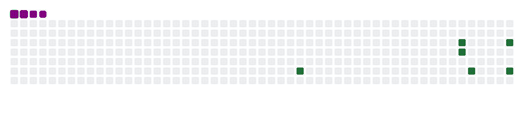

<h1>
  
</h1>

  

 

🔭 Atualmente

- 🎓 Cursando Análise e Desenvolvimento de Sistemas.
- 💻 Desenvolvendo projetos para praticar programação e automação.
- 🌱 Atualmente estou aprendendo Python e automações
- ⚡Acredito que cada projeto é uma oportunidade de aprender algo novo!
  

          
          

